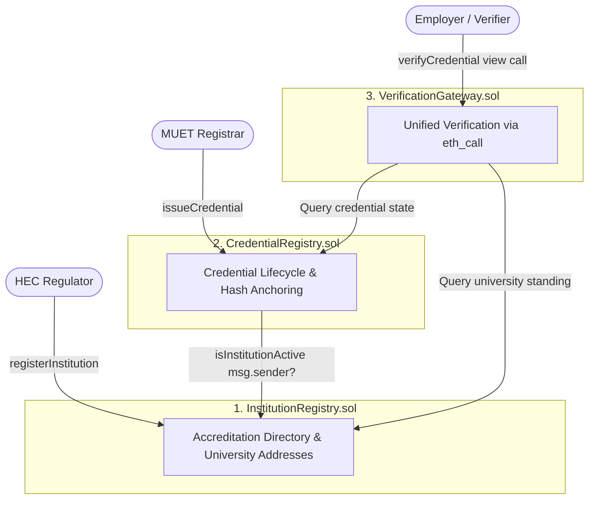

# Decentralized Academic Credential Verification System

**Course:** Blockchain Technologies and Applications (CS-491)  
**Institution:** Department of Computer Systems Engineering, Mehran University of Engineering and Technology (MUET), Jamshoro  
**Project Type:** Complex Engineering Problem (CEP)  
**Academic Session:** 21CS Batch  

---

## 1. Project Overview & Architecture

This repository contains the engineering implementation of a multi-contract decentralized academic credential verification system built on EVM architecture, developed and benchmarked on **Hardhat (Local EVM)**, with a proposed production consortium architecture on **Hyperledger Besu (QBFT)**.

### 1.1 Architecture & Separation of Concerns



1. **`InstitutionRegistry.sol`:** Identity and governance layer managed by HEC (`REGULATOR_ROLE`). Stores accredited university names, regulatory codes, operational statuses, and authorized university issuing wallet addresses.
2. **`CredentialRegistry.sol`:** Core credential lifecycle state machine (`NotFound`, `Issued`, `Revoked`). Validates that issuing entities are active universities. Stores **zero student personal information or student wallet addresses** on-chain.
3. **`VerificationGateway.sol`:** Aggregator contract providing read-only verification via `eth_call` without transaction fees for the verifier, and an optional state-modifying `logVerificationReceipt()` function for audited verifications.

---

## 2. On-Chain vs. Off-Chain Storage Specification

To avoid ambiguity regarding privacy and transparency, the system explicitly defines on-chain versus off-chain data residency:

### Exactly What Resides On-Chain:
1. **In `InstitutionRegistry`:**
   - University signing wallet address (`address institutionAddress`).
   - University legal name (string, e.g., `"Mehran University of Engineering and Technology"`).
   - Accreditation identifier (string, e.g., `"PK-MUET-001"`).
   - Operational status enum (`Inactive`, `Active`, `Suspended`).
   - Registration block timestamp (`uint64 registeredAt`).
2. **In `CredentialRegistry`:**
   - 32-byte cryptographic commitment hash (`bytes32 credentialHash`).
   - Issuing university address (`address issuer`).
   - Issuance block timestamp (`uint64 issuedAt`).
   - Revocation boolean flag (`bool isRevoked`).
   - Revocation block timestamp (`uint64 revokedAt`).

### What Strictly Resides Off-Chain:
- All student Personally Identifiable Information (PII): Full Name, Roll Number, CNIC, CGPA, Major, Graduation Date.
- No student wallet addresses exist on-chain.
- The 256-bit cryptographic secret salt generated via CSPRNG (`crypto.randomBytes(32)`).

---

## 3. Two-Stage Cryptographic Commitment Design

Rather than embedding the salt into the public credential document, the system implements a two-stage cryptographic commitment:

```
[Student Academic Data (Off-Chain)]
         |
         v (Lexicographical Key Sorting)
  Canonical UTF-8 JSON
         |
         v keccak256()
[bytes32 payloadHash]   +   [bytes32 salt] (256-bit CSPRNG, kept private)
         \                       /
          \                     /
       keccak256(abi.encode(payloadHash, salt))
                     |
                     v
       [bytes32 credentialHash] (Anchored on-chain in CredentialRegistry)
```

1. **Stage 1 (Payload Hash):** Credential data is serialized to canonical JSON and hashed with Keccak-256:  
   $$\text{payloadHash} = \text{keccak256}(\text{UTF-8 canonical JSON bytes})$$
2. **Stage 2 (Salted Commitment):** A separate 32-byte random salt is generated. The on-chain commitment is computed using exact EVM ABI encoding:  
   $$\text{credentialHash} = \text{keccak256}(\text{abi.encode}(\text{payloadHash}, \text{salt}))$$
3. **Selective Disclosure & Verification Flow:**
   - The student holds the transcript payload and the secret salt.
   - Publicly circulated transcripts omit the salt.
   - When applying for employment, the student provides the employer with the credential payload and the secret salt.
   - The employer recomputes the commitment locally and calls `verifyCredential(computedHash)` via `eth_call`.

---

## 4. Verification Economics: `eth_call` and Gas Assumptions

1. **Read-Only Verification via `eth_call`:**
   - `VerificationGateway.verifyCredential()` is an `external view` function evaluated via the EVM JSON-RPC method `eth_call`.
   - `eth_call` executes entirely in-memory on the queried Ethereum node. **It does not broadcast a transaction to the network, does not mine a block, and does not charge the verifier any transaction gas fee.**
   - *Technical Note:* The local node executing the query does consume local CPU cycles and memory to evaluate the bytecode, but this is an RPC operational cost, not an on-chain gas fee.
2. **The 30 Gwei Gas Price Assumption:**
   - Any dollar or ETH cost estimates in this repository use **30 Gwei as an illustrative baseline** representing historical public Ethereum L1 gas conditions.
   - This figure is not a current verified gas price for any public network.
3. **Consortium Zero-Gas Reality:**
   - In the proposed Hyperledger Besu consortium, `min-gas-price` can be configured to `0`, eliminating cryptocurrency transaction fees for university nodes.
   - **Zero gas price does not eliminate operational costs:** Dedicated server hosting, node networking, HSM key management, and sysadmin maintenance across HEC and university datacenters require real budgetary allocation.

---

## 5. Implementation vs. Production Architecture Distinction

| Component | Current Working Implementation | Proposed Production Architecture |
| :--- | :--- | :--- |
| **Consensus / Node** | Hardhat Local EVM (Instant automine, Cancun target) | Hyperledger Besu with QBFT ($N=4, F=1, Q=3$) |
| **Testing & Gas** | Hardhat test suite & `benchmarkGas.js` profiling | Besu multi-node testnet with permissioning contracts |
| **Off-Chain Storage** | Local synthetic JSON manifests (`scripts/`) | Decentralized IPFS cluster / Private university vault |
| **Client Interface** | Node.js Ethers.js programmatic CLI & scripts | React/Vite Web3 dashboard with MetaMask integration |
| **Governance Security** | Single-step OpenZeppelin `AccessControl` | Multi-sig (Safe{Wallet}) or `AccessControlDefaultAdminRules` |

---

## 6. Quick Start & Execution Commands

### Prerequisites
- Node.js `v20.x` or `v24.x` (Tested on `v24.18.0`)
- npm `10.x` or `11.x`

### 1. Compile Smart Contracts
```powershell
$env:APPDATA = "D:\BTA\.appdata"; $env:LOCALAPPDATA = "D:\BTA\.localappdata"; npx hardhat compile
```

### 2. Run Automated Test Suite (38 Tests)
```powershell
$env:APPDATA = "D:\BTA\.appdata"; $env:LOCALAPPDATA = "D:\BTA\.localappdata"; npx hardhat test
```

### 3. Run Static Security Linter (Solhint)
```powershell
npx solhint "contracts/**/*.sol"
```

### 4. Run Off-Chain Cryptographic Generator (Synthetic Data)
```powershell
node scripts/generateHash.js
```

### 5. Run Empirical EVM Gas Benchmarks
```powershell
$env:APPDATA = "D:\BTA\.appdata"; $env:LOCALAPPDATA = "D:\BTA\.localappdata"; npx hardhat run scripts/benchmarkGas.js
```

### 6. Run Live Demonstration Workflow (Seed Data)
```powershell
$env:APPDATA = "D:\BTA\.appdata"; $env:LOCALAPPDATA = "D:\BTA\.localappdata"; npx hardhat run scripts/seedData.js
```

---

## 7. Empirical EVM Gas Profiling

The following actual measurements were extracted from `receipt.gasUsed` on mined transactions:

| Module | Operation | Actual Gas Used (Units) | Illustrative Cost @ 30 Gwei (ETH) | Engineering Notes |
| :--- | :--- | :--- | :--- | :--- |
| **InstitutionRegistry** | Deployment | 959,399 | 0.028782 ETH | Base RBAC & pausable contract deployment |
| **CredentialRegistry** | Deployment | 896,778 | 0.026903 ETH | Core lifecycle storage deployment |
| **VerificationGateway** | Deployment | 568,189 | 0.017046 ETH | Query aggregator deployment |
| **InstitutionRegistry** | `grantRole(REGULATOR_ROLE)` | 51,485 | 0.001545 ETH | On-chain governance permission update |
| **InstitutionRegistry** | `registerInstitution(MUET)` | 144,987 | 0.004350 ETH | Mined on-chain university onboarding |
| **InstitutionRegistry** | `updateInstitutionStatus(Suspend)` | 34,245 | 0.001027 ETH | Disciplinary state update |
| **CredentialRegistry** | `issueCredential(1 hash)` | 56,389 | 0.001692 ETH | Cross-contract auth check + `SSTORE` |
| **CredentialRegistry** | `batchIssueCredentials(5)` | 168,289 | 0.005049 ETH | ~33,658 gas per degree |
| **CredentialRegistry** | `batchIssueCredentials(25)` | 716,266 | 0.021488 ETH | ~28,651 gas per degree |
| **CredentialRegistry** | `batchIssueCredentials(50)` | 1,401,266 | 0.042038 ETH | **~28,025 gas per degree (>50.3% gas reduction)** |
| **CredentialRegistry** | `revokeCredential()` | 56,081 | 0.001682 ETH | Mined state transition to Revoked |
| **VerificationGateway** | `verifyCredential()` | **0** | **0.000000 ETH** | **Evaluated via `eth_call`: no tx fee charged to verifier** |
| **VerificationGateway** | `logVerificationReceipt()` | 52,248 | 0.001567 ETH | Optional mined transaction for public audit log |

---

## 8. Privacy, Security & Legal Disclaimers

1. **Synthetic Data Only:** All student names, roll numbers, and grades in this repository are strictly synthetic test fixtures. No real student records or production keys are committed.
2. **Solhint Qualification:** Solhint is an AST-based linter for syntax and best-practice checks; it does not constitute a formal mathematical security audit.
3. **Slither Environment Limitation:** Slither requires Python and `solc-select`, which are unavailable in the host Windows development environment. Dockerized or WSL2 alternatives are specified for formal auditing.
4. **Legal Compliance Notice:** System architecture is engineered in accordance with privacy principles (data minimization, off-chain PII, crypto-shredding), but formal legal compliance under GDPR or Pakistan's Electronic Transactions Ordinance (ETO 2002) requires formal institutional legal counsel.
